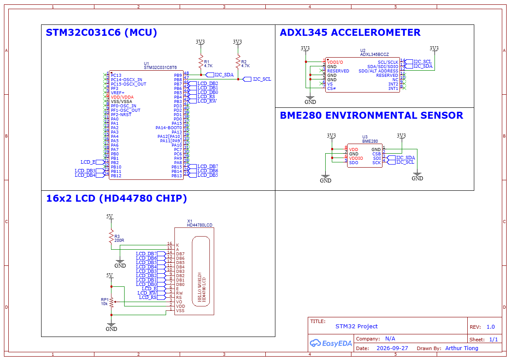
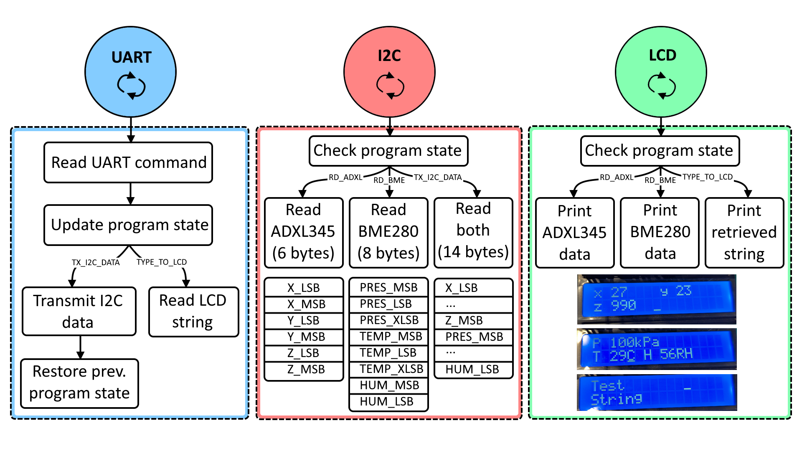
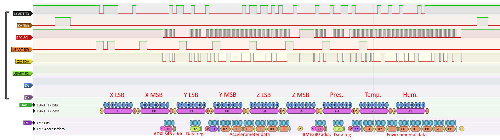
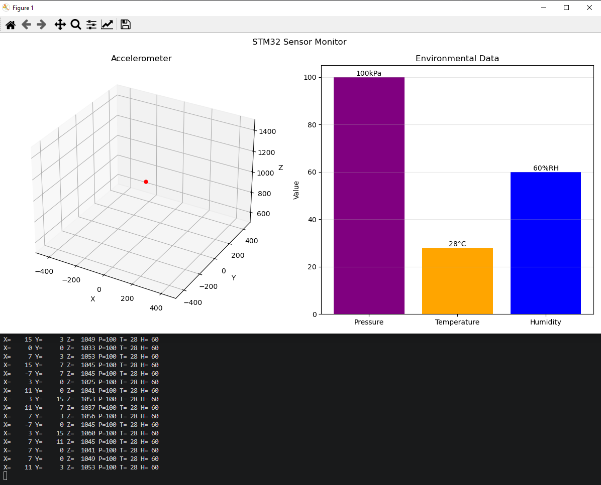

# About
This is a bare-metal C program that interfaces with an ADXL345 accelerometer and BME280 environmental sensor on the same I2C bus, as well as a 16x2 LCD display from a NUCLEO-C031C6 development board. This repository contains custom-written driver code that interfaces with each device and the Minimal RTOS driver (`miros.h`, `miros.c`) provided by the [Quantum Leaps Embedded Systems Programming Course Lesson 26](https://github.com/QuantumLeaps/modern-embedded-programming-course/tree/main/lesson-26/stm32c031-keil). To interface with the official [BME280 API](https://github.com/boschsensortec/BME280_SensorAPI) provided by Bosch (`bme280.h`, `bme280_defs.h`, `bme280.c`), an additional driver stage (`bme280_intf.h`, `bme280_intf.c`) is implemented. A Python dashboard program, `stm32_display_data.py` that communicates via UART to the MCU is also provided. It is a simple project created as part of my learning journey in embedded systems programming and as such, should not be applied in any professional products.

# Components

| #   | Component                       |
| --- | ------------------------------- |
| 1   | NUCLEO-C031C6 development board |
| 2   | ADXL345 accelerometer           |
| 3   | BME280 environmental sensor     |
| 4   | 16x2 LCD (HD44780 chip)         |

# Pinout
## Circuit

The NUCLEO-C031C6 was used, not the on-board STM32C031C6 chip itself. This schematic is not a PCB design and was only made to show the connections between components.

## ADXL345

| NUCLEO-C031C6                      | ADXL345 |
| ---------------------------------- | ------- |
| PB9 ($4.7k\Omega$ pull-up to 3.3V) | SDA     |
| PB8 ($4.7k\Omega$ pull-up to 3.3V) | SCL     |
| 3.3V (SPI unused)                  | CS      |
| 3.3V (address is `0x1D`)           | SDO     |
| Not connected                      | INT1    |
| Not connected                      | INT2    |
| 3.3V                               | VCC     |
| GND                                | GND     |
## BME280

| NUCLEO-C031C6                      | BME280 |
| ---------------------------------- | ------ |
| PB9 ($4.7k\Omega$ pull-up to 3.3V) | SDI    |
| PB8 ($4.7k\Omega$ pull-up to 3.3V) | SCL    |
| 3.3V (SPI unused)                  | CSB    |
| 3.3V (address is `0x77`)           | SDO    |
| 3.3V                               | VDD    |
| 3.3V                               | VDDIO  |
| GND                                | GND    |
## LCD
| NUCLEO-C031C6             | LCD |
| ------------------------- | --- |
| PB15                      | DB7 |
| PB14                      | DB6 |
| PB13                      | DB5 |
| PB12                      | DB4 |
| PB11                      | DB3 |
| PB7                       | DB2 |
| PB6                       | DB1 |
| PB5                       | DB0 |
| PB4                       | RS  |
| PB3                       | R/W |
| PB2                       | E   |
| 5V                        | VCC |
| GND                       | GND |
| 5V                        | BLA |
| GND                       | BLK |
| Potentiometer (GND to 5V) | VO  |

# Program Flow

The diagram above shows the state machine associated with each RTOS thread (UART, I2C, LCD).
# Threads
| Thread # | Function                                                          | Priority    |
| -------- | ----------------------------------------------------------------- | ----------- |
| 0        | Idle thread (low power mode)                                      | 0 (lowest)  |
| 1        | LCD print                                                         | 1           |
| 2        | I2C transmission (ADXL345 and BME280)                             | 2           |
| 3        | UART reception and transmission (receive commands, transmit data) | 3 (highest) |

# Interrupt Priorities
| Interrupt | Priority    |
| --------- | ----------- |
| SysTick   | 0 (highest) |
| UART      | 1           |
| I2C       | 2           |
| PendSV    | 3 (lowest)  |

# UART Commands
All UART commands transmitted from PC to the NUCLEO-C031C6 follow the format:
$$<start\,byte><8\,bit\,command><operands><stop\,byte>$$
Data transmitted from NUCLEO-C031C6 to PC is interpreted as:
$$<\dots><xh><xl><yh><yl><zh><zl><pres><hum><temp><\dots>$$
Where $xh$, $xl$, $yh$, $yl$, $zh$, $zl$, $pres$, $hum$, $temp$ are all 8-bit, i.e. 9 bytes total. If the PC requests 100 x 9-byte measurements, a newline character, `\n` is appended to the 100th byte to denote the end of the transmission.

>**Note:**
>This data format is the UART data format transmitted by the MCU to the PC when requested. It is not to be confused with the I2C data format received from ADXL345 and BME280 data sensors. For e.g. ADXL345 transmits 6 data bytes while BME280 transmits up to 8 data bytes (depending on oversampling and IIR filter settings). Refer to the program flow for more details.

| Command | Function                                                                                     | Usage                                                                                                                   |
| ------- | -------------------------------------------------------------------------------------------- | ----------------------------------------------------------------------------------------------------------------------- |
| 0x01    | Idle in low power mode (default)                                                             | PC->MCU: 0xFD, 0x01, 0xFE                                                                                               |
| 0x02    | Display ADXL345 measurements on LCD                                                          | PC->MCU: 0xFD, 0x02, 0xFE                                                                                               |
| 0x03    | Display BME280 measurements on LCD                                                           | PC->MCU: 0xFD, 0x03, 0xFE                                                                                               |
| 0x04    | Transmit BME280, ADXL345 data in byte pairs (x->pressure->y->temperature->z->humidity) to PC | PC->MCU: 0xFD, 0x04, number of 9-byte measurements (N), 0xFE  MCU->PC: 9-byte measurements x N, newline character |
| 0x05    | Type string to LCD                                                                           | PC->MCU: 0xFD, 0x05, string, 0xFE                                                                                       |
| 0xFD    | Start byte                                                                                   | Used to denote start of data transfer from PC->MCU                                                                      |
| 0xFE    | Stop byte                                                                                    | Used to denote end of data transfer from PC->MCU                                                                        |

# Logic Analyzer Traces

The diagram above shows UART transmissions and I2C reads happening concurrently. Although the current thread being executed is the I2C thread, the UART interrupt still executes and pre-empts the I2C interrupt due to its higher priority level.
>**Note:**
>The ADXL345 and BME280 data received on the I2C bus are different from the data transmitted to the PC via UART. This is because the MCU performs some processing before transmitting the data, e.g. multiplying accelerometer bytes by $3.9mg/LSB$ (full-resolution mode) and performing compensation formulas on environmental data according to the Bosch API.

# Dashboard Program

> **Note:**
> It does not make sense to plot accelerometer data on a 3D plot. Instead, absolute position should be computed through integration. However, I thought it would be a neat visualization.
# TODO
This section outlines the tasks required for the current scope of this project.
- [ ] Add UART command recognition for controlling functionality (state machine).
	- [ ] Add functionality for low power mode.
	- [x] Add functionality to update program state machine through `BSP_updateProgramState()`.
	- [x] Add functionality for displaying ADXL345 and BME280 measurements on LCD.
	- [x] Add functionality for transmitting ADXL345 and BME280 data to PC.
	- [x] Create Python file to parse UART data and generate `.csv` files to store data.
- [x] Implement DMA to UART and I2C interrupts.
- [ ] Add Doxygen comments.
- [x] Add Clang formatting.
- [ ] Add instructions for building and flashing code on `README.md`.
- [ ] Try out event-driven programming paradigm instead of RTOS.
- [ ] Add error handling, e.g. return codes, write function body for `HardFault_Handler` or other exception handlers, watchdog timer.
- [ ] Replace all HAL code, e.g. `NVIC_SetPriority` with bare metal code.
- [x] Create notes for all STM32C031C6 peripherals used.
- [ ] Study I2C, UART and RTOS task timing.
	- [ ] Analyze CPU utilization.
	- [ ] Find the best values for non-blocking delays - use rate-monotonic scheduling (RMS)?
- [ ] Analyze Flash and RAM memory usage from linker map file.
- [x] Document on Github.
	- [x] Make `README.md`.
	- [x] Create program flow chart.
	- [x] Create diagram to show UART command protocol used to communicate with MCU.
- [ ] Fix bugs.

# Bugs
This section outlines the software bugs currently faced and their fixes.
- [ ] Current UART reception on MCU side depends on the `0xFE` stop byte. If any data byte happens to be `0xFE`, transmission might end abruptly. Coincidentally, data bytes transmitted never happened to be `0xFE`, however, this is not good design.
	- Solution - UART command protocol should be redefined as `START->COMMAND->LENGTH->PAYLOAD->CRC`.
- [ ] Analyze why `debug_write()` in UART ISR leads to code freezing in `OS_tick()` with `t->timeout` and `t->prio` being invalid (stack overflow/corruption?).
- [ ] Occasionally, the program does not send any bytes when requested by PC.
- [x] When transmitting data to the PC, data read from ADXL345 and BME280 must be ready before sending an UART transmission.
	- Solution - both `ADXL345_readData()` and `bme280_intf_getSensorData()` should return `1` when new I2C data has been read into the buffers and `0` otherwise. `tx_data_ready = adxl345_data_ready && bme280_data_ready` is used as a flag to determine if UART data transmission is ready to be performed.
- [x] When using DMA for I2C transfers of ADXL345 and polling for I2C transfers of BME280, switching from ADXL345->BME280->ADXL345 starts reading garbage `x`, `y`, `z` values.
	- Solution - `RXDMAEN` and `TXDMAEN` flags were not reset when switching back to ADXL345 measurements.
- [x] Program does not always read UART data, this causes MCU to occasionally miss commands, e.g. MCU does not transmit any data back when requested from the PC.
	- Solution - have UART receiver always enabled so that it can always receive data instead of enabling receiver in thread. The thread only performs transmission when requested by the PC.
- [ ] Transmitting UART data to the PC freezes after some time when `debug_write()` is called inside `USART2_IRQHandler`.
- [ ] When multiple peripherals try to access DMA at the same time, a single global, static DMA configuration object is defined. The second peripheral to initialize the DMA configuration object redefines it and overwrites the previous one.

# Future Improvements
This section outlines major improvements that can be made to the project.
- BME280 driver code by Bosch expects `dev->read()` and `dev->write()` functions to be polling-based as the data read needs to be formatted (byte reconstruction) and compensated immediately after return. Moreover, local variables, `reg_data` and `uncomp_data` were used to store data. When `bme280_get_sensor_data` returns, values stored in these variables are lost. A custom interrupt-based driver using global variables can be written.
- TXFIFO and RXFIFO for UART can be used to reduce interrupt overhead.
- SPI and DMA can be used together for data transfer instead of I2C since SPI supports higher frequencies.
- Write more complete driver code, e.g. options to use ADXL345 interrupts like `DATA_READY` and `WATERMARK`, shifting text on LCD display or DMA capability for SPI.
